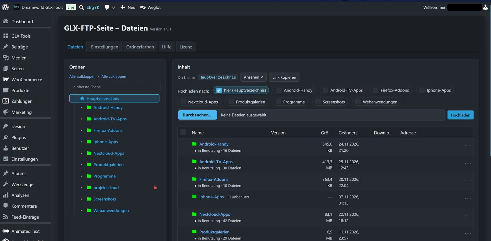
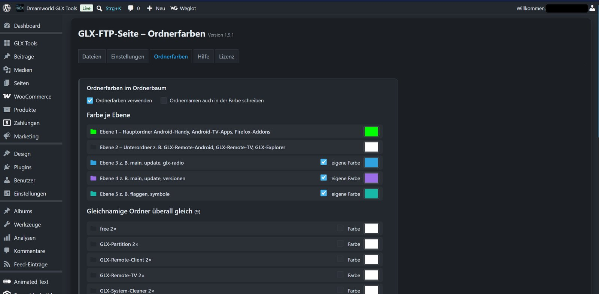
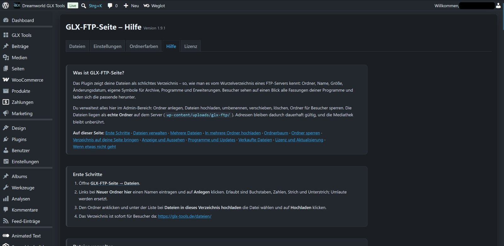

🌍 Languages: [🇺🇸 English](README.md) | [🇩🇪 Deutsch](README.de.md)

# 💠 GLX FTP-Seite

### Your WordPress site as a software download server.

*Folders, versions, signed buyer links and download statistics, with no external services.* ⚡

   

---

## ⬇️ Download

👉 Latest version: [Releases](../../releases/latest)  
👉 Shop and licences: [glx-tools.de](https://glx-tools.de/product/glx-ftp-seite/)

---

## 📖 About GLX FTP-Seite

### Your WordPress site as a software download server

GLX FTP-Seite turns a WordPress site into a download server for software. Visitors see folders, names, sizes and dates at a glance, just like the root directory of an FTP server, and download the right version of your programs. Your media library stays untouched.

### Manage files like in Explorer

A folder tree with file list and context menu: copy link, copy licence path, rename, move, copy and delete. Move, copy and merge whole folders and decide in a Windows-like conflict dialog whether to overwrite, keep both or cancel. Very large setups are uploaded in chunks and resume after an interruption.

### Locked folders and sold downloads

Locked folders block direct links. Buyers get personal, signed links that expire, created automatically together with GLX License as soon as payment has arrived. You decide who may enter a folder: admins, logged-in users or selected roles and users.

### Versions, statistics and automatic uploads

Version numbers are read from version.json or Was-ist-neu.txt, also for DMG, PKG and APK files, so your programs can offer updates themselves. Every file has a download counter, and an upload interface with key lets GLX Auto-Upload deliver new versions automatically. No external services.

---

## 📸 Overview & Screenshots

### 1️⃣ File manager in the WordPress admin with folder tree and upload

### 2️⃣ Folder colours per level and for folders with the same name

### 3️⃣ Built-in help with first steps

---

## ✨ Features

- 🚀 **Download server in WordPress:** Folder tree and file list with context menu: copy link, licence path, rename, move, copy, delete.
- 🧩 **Folder operations:** Move, copy and merge whole folders with a Windows-like conflict dialog.
- ⚙️ **Large uploads:** Uploads in chunks, so even very large setups arrive safely.
- 🔒 **Automatic versions:** Reads version numbers from version.json or Was-ist-neu.txt, also for DMG, PKG and APK.
- 📂 **Locked folders:** Direct links are blocked; buyers get signed links that expire.
- ⚡ **Download counter:** Counts the downloads of every file.
- 🎨 **Statistics:** Main and update downloads in GLX Visitors, admins are not counted.
- 🌍 **GLX Auto-Upload interface:** New versions arrive automatically with an upload key, no FTP account needed.
- 🛠️ **Shop and updates:** Connected to GLX License for shop downloads and automatic plugin updates.
- 📊 **No external services:** Everything runs on your own WordPress site; resizable tree and remembered scroll position.

---

## 🧩 Requirements

- WordPress
- PHP 8 or newer

---

## 🧪 Trial & License

Available at [glx-tools.de](https://glx-tools.de).

---

## 🔗 More about this product

👉 [glx-tools.de](https://glx-tools.de/product/glx-ftp-seite/)  
For support: **info@glx-tools.de**

---

## 📄 License

Copyright © 2026 GLX Tools – Gordon Lehmann. All rights reserved.  
This is proprietary commercial software. No open-source license is granted. This repository contains release downloads and documentation only; the source code is not published.

---

Made with ❤️ by **Dreamdancer100**

